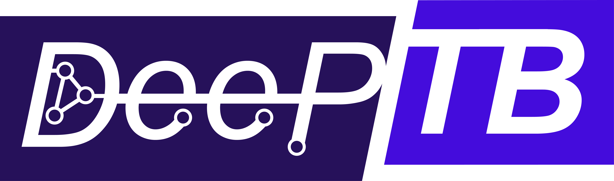

<p align="center">
  
</p>

# DeePTB

DeePTB uses deep learning to build tight-binding models and predict Hamiltonian, density, and overlap matrices in an atomic-orbital basis. It supports electronic-structure prediction, band analysis, and spin-orbit coupling.

The maintenance branch is **`1013-stable`**. See the [architecture guide](docs/architecture.md) for component ownership and construction APIs, and the [maintenance release guide](docs/1013-stable.md) for interface contracts.

## Models and interfaces

| Component | Purpose |
| --- | --- |
| DeePTB-SK | Slater–Koster parameterization and local-environment corrections |
| DeePTB-E3 | Equivariant atomic-orbital operator prediction, including upstream embedding interfaces |
| UniTB | `unitb` embedding with PDQ-MoE by default; a single expert selects UniTB-dense; legacy checkpoint compatibility |
| `lem`, `slem` | Upstream baselines without prior inputs |
| `lem_prior`, `slem_prior` | Baselines with prior inputs |
| `dptb.prior` | Physical priors on the GPU: `prior.h0` (UniTB H0), `prior.gf` (Flash GF), shared operators in `prior.common`, table builders behind `dptb prior build` |
| `dptb.inference` | Fused inference engine: geometry to H, S (and the UniTB residual) on the device for both routes |

UniTB uses an **H₀-routed shared-basis mixture of experts (PDQ-MoE)**. Select it with `{"method":"unitb"}`; add `"num_experts":1` for UniTB-dense. Charge equilibration and training-only prior noise are configured separately. See the [UniTB guide](docs/unitb.md) and [configuration examples](examples/unitb/README.md).

`lem` and `slem` retain the pinned upstream implementations and do not consume priors. Use `lem_prior` or `slem_prior` for prior inputs. The [baseline guide](docs/embedding_baselines.md) describes prior sources, missing-input behavior, and legacy checkpoint handling.

Training and evaluation support LMDB, overlap and prior sidecars, `multi_train`, HybridMuon, spectral clipping, and band postprocessing. Input configurations specify the model, data, and optimization settings.

[SO2CUDA](https://github.com/Franklalalala/SO2CUDA) provides optional CUDA acceleration through DeePTB's backend interface. DeePTB also provides a PyTorch reference path. With SO2CUDA 0.3.0 installed, eligible CUDA inputs use the accelerated route automatically. Backend selection preserves model parameter layouts; numerical differences, training behavior, and performance must be checked for the intended inputs, precision, and device. Set `DPTB_SO2_M_LINEAR_MODE=standard` for the true-dense reference route or `SO2_CUDA_BACKEND=off` to disable SO2CUDA. See the [backend guide](docs/so2_backend.md). [LoopSCF](https://github.com/Franklalalala/loopscf) is maintained separately and uses DeePTB's model and data interfaces.

## Installation

Use a separate environment; the supported Python range is specified in [pyproject.toml](pyproject.toml). Install [PyTorch](https://pytorch.org/get-started/locally) for your device, then a matching `torch-scatter` and DeePTB:

```bash
git clone --branch 1016-stable https://github.com/Franklalalala/DeePTB.git
cd DeePTB
python docs/auto_install_torch_scatter.py
python -m pip install -e .
```

For CUDA acceleration, install the optional SO2CUDA dependency with a CUDA toolchain compatible with PyTorch:

```bash
python -m pip install -e '.[so2]'
```

The priors and the inference engine are PyTorch and Triton; the GF prior's three-centre sums use a small CUDA extension on FP64 tensor cores when a CUDA toolkit is available (compiled on first use, Triton otherwise). See [prior pipelines](docs/prior_pipeline.md) for the steps both priors share, their timings and constants, [1015-stable](docs/1015-stable.md) for the layout, the inference engine and table building (`dptb prior build`), [1016-gf](docs/1016-gf.md) for the GF prior and [1016-h0](docs/1016-h0.md) for the H0 prior.

## Usage and validation

Use `dptb` for training, evaluation, and postprocessing; `dptb --help` lists the commands. See the [basic API](docs/quick_start/basic_api.md) and [input configuration guide](docs/quick_start/input.md).

```bash
dptb prior --help
python tools/test.py
python tools/test.py dptb/tests/test_record_codec.py
```

Python callers use `dptb.nn.build_model` for complete models; `dptb.nn.embedding.Embedding(method, **options)` builds a single embedding. The standard training commands apply across model families. H0 reconstruction and table preparation use `dptb h0`; see the [H0 guide](docs/h0.md).

[TESTING.md](TESTING.md) describes test coverage, optional dependencies, and full-suite commands. The short suite checks installation and common interfaces. Checkpoint and numerical regression checks are required separately for changes affecting model behavior.

## Documentation and citations

The [online documentation](https://deeptb.readthedocs.io/en/latest/) provides general tutorials. The in-repository documentation defines this branch's UniTB, prior, and component contracts. Contribution guidance is in [AGENTS.md](AGENTS.md) and [CONTRIBUTING.md](docs/CONTRIBUTING.md).

Please cite the relevant work when using DeePTB:

- **DeePTB-SK**: Q. Gu et al., *Deep Learning Tight-Binding Approach for Large-Scale Electronic Simulations at Finite Temperatures with Ab Initio Accuracy*, [Nature Communications 15, 6772 (2024)](https://doi.org/10.1038/s41467-024-51006-4).
- **DeePTB-E3**: Z. Zhouyin et al., *Learning Local Equivariant Representations for Quantum Operators*, [ICLR 2025](https://openreview.net/forum?id=kpq3IIjUD3).

Full reference entries are in [CITATIONS.md](docs/CITATIONS.md).
