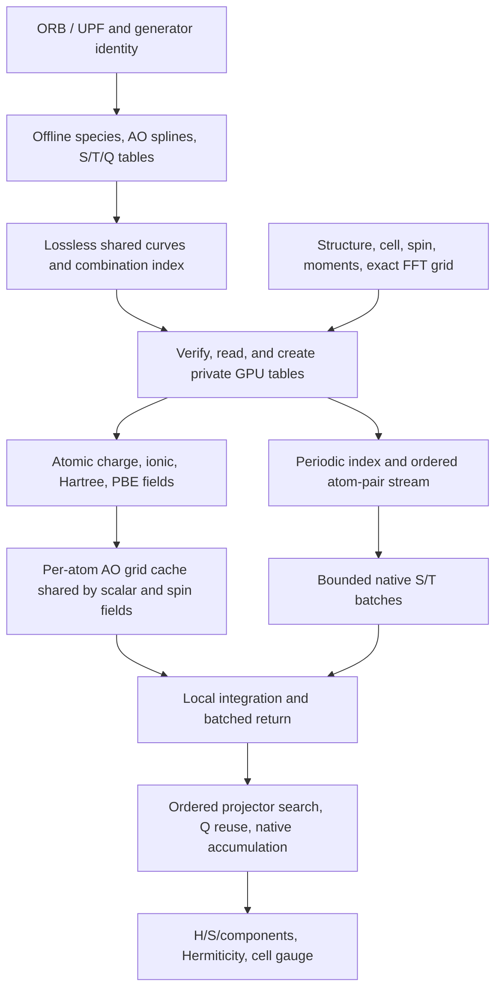

# Offline physical H0 prior

`dptb.priors.h0` is the authoritative engine for the atomic-charge operator
`H[rho0] = T + Vnl + Vion + VH[rho0] + Vxc[rho0]` and overlap S. It is an
offline physical prior subsystem, independent of neural model embeddings.
Compare it with the initial operator built from identical physical inputs.
NACF remains in `dptb.nacf`.

## Commands and installation

The engine ships in the DeePTB wheel, including native CUDA source resources.
The CUDA binaries are built explicitly in a compatible Linux Python/PyTorch/
CUDA/pyabacus environment; importing H0 never invokes a compiler.

Numerical reconstruction requires Python 3.10 or newer and SciPy 1.15 or newer
for `scipy.special.sph_harm_y`. This optional offline-engine requirement does
not change the core DeePTB Python 3.9 support. Command help, package resources,
and precomputed-prior model inference do not import the reconstruction engine.

```bash
export H0_WORK_ROOT=/path/to/external/h0-work
export H0_OFFLINE_TABLE_DIR=/path/to/prepared/offline_tables
export ABACUS_SOURCE_DIR=/path/to/matching/abacus/source
export H0_EXTRA_INCLUDE_DIRS=/path/to/extra/include
python -m dptb.priors.h0 precompile
python -m dptb.priors.h0 precompile --check
python -m dptb.priors.h0 prepare-tables /path/to/raw /path/to/new/store
python -m dptb.priors.h0 reconstruct config.json -o H0_blocks.npz
```

The main DeePTB CLI exposes the same commands as `dptb h0 <command>`.
The Python API is:

```python
from dptb.priors.h0.api import reconstruct_from_files
from dptb.priors.h0.assemble import assemble_h0
from dptb.priors.h0.offline import prepared_two_center
```

The optional `env.sh` configures temporary directories and caches beneath an
explicit `H0_WORK_ROOT`; it does not activate an environment or select a GPU.
Build discovery uses the currently imported
pyabacus ModuleNAO, the current Python include/lib directories, and the explicit
ABACUS source tree. Configure `CUDA_HOME` and dynamic-library search paths for
that same environment. See [native installation](#native-installation).

## Layout

The engine lives in `dptb/priors/h0`; offline commands are modules under
`dptb.priors.h0.cli`, the explicit native builder is `dptb.priors.h0.precompile`,
and tests are in `dptb/tests/h0`. The former root `h0/` scripts map to
`dptb h0 <command>` (for example `python h0/prepare_tables.py` becomes
`dptb h0 prepare-tables`; the finite reference acceptance is `dptb h0 accept`).

Artifact schemas, feature keys, units, spin packing, and numerical defaults
retain their existing meanings. Native manifests and prepared-table contracts
hash their actual source files; source edits invalidate old claims. Explicitly
build a new installation and prepare a new store when verification rejects a
changed identity. Do not rename or restamp old manifests.

## Physical and artifact contracts

`assemble_h0` receives structure, species, physical cutoffs, the exact FFT grid,
spin, and initial magnetic moments. `dptb.priors.h0.deeptb` validates provenance,
energy units, structure identity, graph coverage, and real-space Hermiticity
before DeePTB packs complex AO blocks. The bridge itself imports neither
PyTorch nor neural model code. `production_io.load_case` reads ABACUS physical
inputs and a separate post-construction CSR reference.

Use `pair_support='nonlocal_complete'` for complete nonlocal block support.
The default `orbital_overlap` can omit a nonzero third-center nonlocal
contribution. `strict_reproduction=True` does not change that support choice.
See [assembly and CUDA hot path](#assembly-and-cuda-hot-path) and [offline stores](#offline-stores).

`output_atom_cell_shifts` specifies integer lattice shifts. If
`r_out_i = r_in_i + q_i @ cell`, H0/S/component keys transform as
`R_out = R_in + q_i - q_j`; serialized coordinates and their fingerprint change
with them. Matrix values and periodic fields retain their physical meaning.
The default retains input coordinates. `cell_gauge` checks integer shifts and
rebases results; reference input rejects true displacements or reordered atoms.

## Explicit SOC reference alignment

`soc_reference.align_soc_projectors` and `SOC_REFERENCE_DR_BOHR` implement the
ABACUS `USE_NEW_TWO_CENTER` reference contract. The reference grid uses
`cutoff=2*rmax`, `nr=int(rmax/0.01)+1`, and odd projector sample counts.
The reference is [ABACUS ee99e3ca](https://github.com/deepmodeling/abacus-develop/tree/ee99e3ca7f64f7c3b33cc6b68bc0bb99ef16599f).
Its projector truncation rounds even `cut_mesh` upward and copies only samples
`ir < cut_mesh`, unlike the UPF reader's inclusive support count.

A nominal 0.02 Bohr request does not guarantee identical grids for every
cutoff: the reference uses `2*rmax/(nr-1)`, whereas CUDA preparation uses
`nr=ceil(2*rmax/requested_dr)+1`. At `rmax=9`, both have 901 points; at
`rmax=5.005`, the reference has 501 points and a 0.02 request has 502. Check
the actual grid for each new cutoff.

Apply alignment once to original species, and use that species and spacing in
both preparation and assembly:

```python
from dptb.priors.h0.soc_reference import align_soc_projectors, SOC_REFERENCE_DR_BOHR
species = align_soc_projectors(original_species)
table = prepared_two_center(
    species, store=new_store, dr_bohr=SOC_REFERENCE_DR_BOHR,
    nspin=4, device='cuda:0', prepare=True,
)
result = assemble_h0(
    structure, species, **physics_options,
    two_center_backend='pyabacus', two_center_dr_bohr=SOC_REFERENCE_DR_BOHR,
    offline_table_dir=str(new_store), **runtime_options,
)
```

The original projector `cutoff_radius` remains a conservative support/grid
bound and can differ from `r[cutoff_index-1]`. An all-below-threshold projector
uses the available mesh to bound sample count. Preserve original species to
avoid double alignment. Existing frozen stores and generic preparation do not
automatically opt into this reference-specific transformation.

## Native installation

Run `python -m dptb.priors.h0 precompile` explicitly in the compatible Linux
environment, followed by `python -m dptb.priors.h0 precompile --check`.
The convenience `build_once.sh` uses the same module entrypoint under a lock.
Set `H0_WORK_ROOT` to an external writable task directory for build products
and caches. Environment, headers, and library discovery are described in
[commands and installation](#commands-and-installation).

Native sources are wheel resources in `dptb.priors.h0/csrc`. The installation
builder places the verified `_cuda_two_center.so` and `_cuda_local_grid.so`
alongside the engine and records their manifests in `prebuilt/`. The binary
and manifests must match the actual Python/PyTorch/CUDA ABI, source contents,
dependencies, and target device. Package installation must permit those
explicit installation-time writes.

Ordinary imports and inference never launch a compiler. An existing manifest
cannot be made current by renaming its paths or changing its stored hashes.
Keep immutable old installations intact and create a fresh qualified
installation when rebuilding for a new identity.

## Offline stores

Prepare species and two-center radial tables explicitly with
`python -m dptb.priors.h0 prepare-tables RAW STORE`, or the
`dptb.priors.h0.offline` API. Installation and assembly are described above.

Each store binds source contents, spin, radial grid, numerical generator,
dependencies, and native binary identity. Inference reads a matching prepared
store; it never repairs a missing table or compiles a backend. When a contract
changes, prepare a new directory instead of changing the old manifest.
`H0_OFFLINE_TABLE_DIR` selects the store for reference commands and defaults to
`H0_WORK_ROOT/offline_tables` when the work directory is explicitly configured.

The species codec is pickle-free and stores allowed dataclasses by their class
name and fields. Moving their Python module does not alter the file format.
Generator source edits still invalidate the strict numerical source contract.
See [shared radial tables](#shared-radial-tables-and-projector-search) for lossless compaction.

## Shared radial tables and projector search

The shared store deduplicates identical S/T/Q curves across combinations.
It stores uniform cubic Hermite endpoints, tail coefficients, and sparse bit
corrections. Original grids, coefficients, species, complex SOC D matrices,
indices, and generator contracts remain intact. Not-a-knot AO splines retain
their original format instead of using the Hermite codec.

```bash
python -m dptb.priors.h0 compact-tables /path/to/original /path/to/new/shared
```

The source is read-only. A discoverable manifest is published only after every
decoded combination passes its original state checksum. Incomplete output is
retained for diagnosis; retry in a new directory. Runtime discovers complete
stores through `shared_radial.json` and expands original FP64 tensors. SQLite
is read-only, decoded coefficient bytes participate in hashing, and damaged
records or incompatible floating-point arithmetic fail verification.

```python
result = assemble_h0(
    ..., offline_table_dir='/path/to/new/shared',
    projector_reuse_max_mb=256,
    projector_search='anchor', spatial_backend='indexed',
)
```

The default search is `midpoint`. `anchor` uses atom `ci` and radius
`orbital_cutoff_i + max_projector_cutoff`: a contributing projector must overlap
AO i and therefore lies inside this candidate sphere. All outgoing edges of
atom i reuse sorted candidates; the original two species-distance tests and
native contraction decide actual contributions, including repeated periodic
images. Atom/translation order remains unchanged and only current-atom
candidates are cached.

Compaction applies to already prepared curves; unseen grids and combinations
still require explicit preparation. CUDA uses expanded four-coefficient
tables, so disk compression does not imply equal GPU memory savings. The Q
cache budget covers retained Q tensors, not the whole assembly working set.
`kernel_nonlocal_seconds` includes the wrapper through completed CPU results;
S/T call counts and timings are reported separately.

## Assembly and CUDA hot path

The engine builds atomic-charge `H0 = T + Vnl + Vion + VH[rho0] + Vxc[rho0]`
and S. Its reference is ABACUS initial HR0, before a density update or SCF
convergence.



### Data lifetimes

| Data | Identity | Reuse |
|---|---|---|
| Species and radial tables | ORB/UPF, spin/scalarization, grid, generator, binary | All structures with matching inputs |
| Shared curves | Grid and complete decoded coefficient bytes | Identical curves only; no grid interpolation |
| Master GPU tables | Table key, directory, device | Two-entry process LRU; consumers retain private copies |
| Charge and fields | Current geometry, grid, electrons, initial moments | Current assembly only |
| AO grid cache | Current orbitals, coordinates, FFT grid | Assembly LRU shared by scalar and spin fields |
| Projector candidates | Current source atom, geometry, session, cutoffs | Current atom's outgoing edges |
| Q factors | Species IDs and exact float64 displacement bytes | Assembly with explicit memory budget |
| S/T/local output buffers | Current bounded pair batch | Default 128 pairs; no prebuilt full N-squared output |

`pair_batches.scalar_pair_batches` makes one native S/T call per batch and
returns each tensor once, removes padding, then copies independent NumPy
blocks. Edge order and displacement arithmetic remain unchanged.
`CudaPeriodicFFTGridAOCache.contract_chunk` retains native pair integration
and returns one bounded batch. Scalar and spin fields share AO values,
lookup, and geometry support.

`PreparedProjectorCandidates` filters the fixed left atom once and uses arrays
for the right atom. Points near cutoff planes still use the original scalar
norm test; no epsilon expands support. Candidate order and exact Q keys remain
unchanged. Shared-store entry captures the numerical environment once for
contract comparison and key construction; there is no permanently trusted
process identity cache and old source claims are never updated.

### Explicit Python API

Inputs must come from verified physical configuration. Reference comparisons
can use `production_io.load_case(..., prepared_species=...)` for the exact
grid, moments, spin, and output-cell shifts.

```python
from dptb.priors.h0.assemble import assemble_h0
result = assemble_h0(
    structure, species_data, **physics_options,
    offline_table_dir=shared_table_directory,
    two_center_backend='pyabacus', cuda_precompiled=True,
    compute_device='cuda:0', field_backend='torch',
    structure_factor_backend='cufinufft', structure_factor_nthreads=1,
    strict_reproduction=False,
    local_integration='fft_grid_periodic', spatial_backend='indexed',
    pair_support='nonlocal_complete', hermitize=False,
    projector_search='anchor', projector_reuse_max_mb=256,
    cuda_pair_batch_size=128,
    field_max_work_mb=8192, structure_factor_max_work_mb=12288,
    local_cache_max_mb=4096,
)
```

`strict_reproduction=False` is an explicit option for the existing NUFFT route.
Supply the original FFT grid and cutoffs and validate H/S directly; this does
not relax the reference accuracy requirement. Setting `cuda_pair_batch_size=1`
selects single-pair S/T calls but does not restore an entire historical release.
Anchor search and Q reuse retain their explicit selectors. The CPU reference
uses its existing flow. The generic reconstruction CLI does not expose every
CUDA/prepared-store parameter; this Python API supports explicit configuration.

### Memory, timing, and regression boundaries

S/T GPU buffers occupy `2 * batch_size * max_norb**2 * 8` bytes; CPU buffers and
final matrices are separate. Local-output peaks include per-pair results and
the concatenation buffer. `local_cache_max_mb` budgets one shared SOC AO cache;
Q has a separate budget. Fields, master/consumer tables, native pair workspace,
and final matrices are excluded. Shared disk tables expand on GPU, and
nondefault CUDA streams retain event waits and `record_stream` lifetime guards.

End-to-end assembly timings synchronize CUDA before and after `assemble_h0`
and include table verification/load/copy, fields, all blocks, metadata, and
cell conversion. Input parsing, reference-file reads, and output serialization
are excluded. Profiling is diagnostic and its instrumented time is not a speed
claim. Native local integration still includes pair validation, index filters,
and CPU boundary reads.

Changes must preserve all H/S/T/local/nonlocal block keys, shapes, dtype, and
bytes against the fixed baseline, plus independent ABACUS errors. Cover
scalar/SOC, varied orbital counts, periodic images, cutoffs and adjacent float
values, eviction, and nondefault streams. A batch-size change must retain the
physical result. Local performance evidence does not establish full numerical
acceptance or DeePTB end-to-end acceleration.

## Validation

Run `python -m pytest dptb/tests/h0` for the affected boundary. CUDA tests need
verified matching binaries; real reference tests additionally need
`H0_REFERENCE_ROOT` and pyabacus. Reference assets remain external.

Compare H0, S, and physical components, including keys, shapes, dtype, and cell
gauge. Convert Ry energies to eV before reporting errors. Reference alignment
alone establishes neither full-dataset accuracy, integration convergence,
training prior accuracy, nor end-to-end model acceleration.
