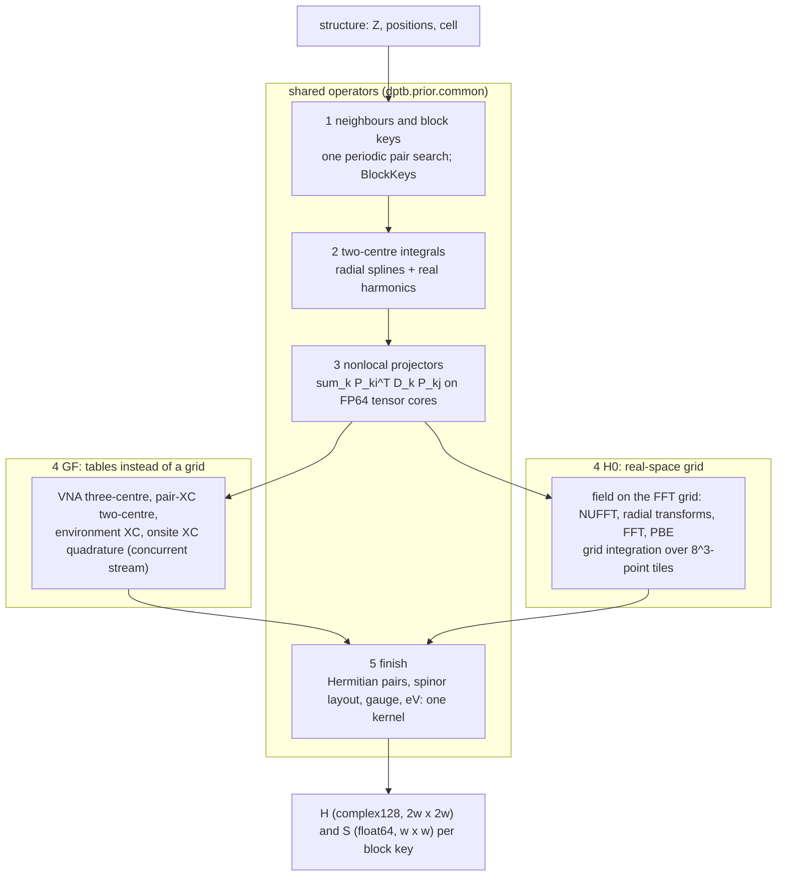
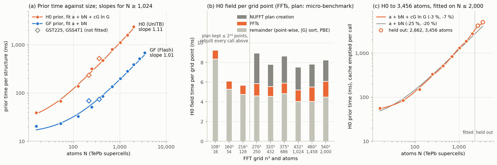

# Prior pipelines: GF (Flash) and H0 (UniTB)

Both priors turn a periodic structure (atomic numbers, positions, cell) into the blocks of a Hamiltonian prior and its
overlap, H_ij(R) and S_ij(R) for atom i in the home cell and atom j at the lattice image R, entirely on the GPU and
without a host round trip of intermediate data. They split the Hamiltonian the same way,

    H = T + V_NL + V_loc + V_xc,

with V_loc the local pseudopotential together with the Hartree potential of the valence charge (in GF the neutral-atom
potentials V_NA = V_loc,ps + V_H[ρ_atom]), and run the same steps with one implementation of each shared operator
(`dptb.prior.common`). They differ in one step only, the local potential and exchange-correlation part (step 4 below):
H0 builds the potential on the real-space FFT grid and integrates it against the orbitals on that grid; GF replaces
this by tabulated two- and three-centre terms and an onsite quadrature on atom-centred grids. The tables stay separate
(H0: the 0.02 bohr pair bank; GF: the P2, overlap, P23, pair-XC and environment-XC families), each as used in
training; the code that evaluates them is shared.

**Methods summary.** For a structure we (1) find all periodic atom pairs within the support radius in one pair search
(fused count and write kernels) and lay the blocks out once (onsite blocks first, then the other keys in sorted order,
each with the row of its reverse (j, i, −R)); (2) evaluate the two-centre integrals from radial tables (cubic splines
in |d| combined with real spherical harmonics of the bond direction: a bond-frame rotation in GF, a Gaunt expansion in
H0); (3) form the nonlocal pseudopotential term Σ_k
P_ki^T D_k P_kj as three-centre sums over shared projector centres, contracted on FP64 tensor cores and written once
per block; (4) add the local potential and exchange-correlation term (route-specific); and (5) Hermitise, apply the
spin-orbit spinor layout, permute to the DeePTB orbital gauge and convert to eV in one kernel. Steps (1)–(3) and (5)
run the same code in both priors on inputs of different size (H0's wider support has twice as many blocks); step (4)
takes 95 % of the H0 prior at 1,024 atoms and accounts for 98 % of the time by which H0 is slower than GF (per-step
times measured serially; 95 % at 216 atoms, 72 % at 16 atoms). Measured from 16 to 3,456 atoms, the GF prior is linear in N
(log-log slope 1.01 above 1,024 atoms); the H0 prior is near-linear up to 2,000 atoms, where its field step costs
7.5–9 ns per grid point (the FFTs an estimated 1–1.6 ns of it), and grows faster beyond (Cost scaling).

## Flow

## Steps

Notation: phi_mu(i) the atomic orbitals of atom i (ABACUS real harmonics), d = x_j + R·cell − x_i, w the largest
orbital count of the structure (blocks are padded to it), herm(M)_b = (M_b + M_rev(b)^H) / 2 with rev(b) the block (j,
i, −R) of b = (i, j, R). A step's input and output stay on the device.

| # | Step | Mathematics | Input → output | GF (Flash) | H0 (UniTB) | Shared operator |
| --- | --- | --- | --- | --- | --- | --- |
| 0 | Tables | — | composition → resident tables | P2, overlap, P23, pair-XC, environment-XC and SOC tables (device cache, 4 GiB) | pair bank S, T, Q (0.02 bohr), AO splines, KB matrices (per composition) | cache per composition, background prefetch |
| 1 | Neighbours, block keys | {(i, j, R)} within the support; rev(b); representative edges (row < reverse row) | Z, x, cell → keys [m, 5], reverse [m], centre queries (a, k, T) | support: direct AO pairs \|d\| < r_c,i + r_c,j, model edges, pairs sharing a projector centre; one search also serves the projector, VNA and density-centre queries (the onsite XC searches its own 27 bohr neighbours on its stream) | support: \|d\| ≤ r_c,i + r_c,j + 2 max r_β; one search also serves the projector queries | `neighbors.PairBase`, `neighbors.centre_queries`, `blocks.BlockKeys` |
| 2 | Two-centre | ⟨phi_mu(i)\|O\|phi_nu(j)⟩ | keys, vectors → S, T (H0) or base, overlap (GF) [m, w, w] | bond-frame splines C(\|d\|) rotated, D_L(d̂) C D_R(d̂)^T; base = T + V_NA,i + V_NA,j | Σ_L i^(l1−l2−L) [S_L(R)/R^L] Σ_M G(l1m1, l2m2, LM) R^L Y_LM(d̂) | `radial.horner`, `radial.interval_uniform`, `blocks.search_sorted`, `harmonics.real_ylm`, `radial.pair_groups` |
| 3 | Nonlocal | V_NL,ij(R) = Σ_k Σ_images P_ki^T D_k P_kj | queries, P tables, D → real part [m, w, w] and spin-orbit channels [m, 4, w, w] | P from the P2 projector tables | P from the bank's Q tables | `threecentre.projector` (`three_centre_terms`, `contract`, `dmma.pair_sum`, `KBMatrices`) |
| 4 | Local potential and XC | V_loc + V_xc | route-specific | VNA Σ_k F_ki^T diag(ε_k) F_kj over the VNA centre images other than the block's own two atoms (P23; their V_NA is in the two-centre base); pair-XC ⟨mu\|v_xc[ρ_i + ρ_j]\|nu⟩ (table); environment XC (McWEDA moments); onsite XC Σ_g w_g phi_k phi_l v_xc(ρ_a) on atom-centred grids | V = V_loc + V_H + V_xc^PBE on the FFT grid (NUFFT structure factors, radial transforms on the charge sphere, FFT); V_ij(R) = ΔV Σ_r phi_i(r) V(r) phi_j(r − R) over 8³-point tiles | `threecentre.contract` (VNA, environment moments), `xc.pz81` (GF), `neighbors.inside`/`any_of` (H0 tile and AO support), `harmonics.real_ylm`, `radial.horner` |
| 5 | Finish | C = herm(scalar part); H = [[C + i Im X_uu, X_ud], [X_du, C + i Im X_dd]]; ABACUS → DeePTB gauge; eV | C, X, S → H [m, 2w, 2w] complex128, S [m, w, w] | C = herm(Ry herm(base + V_NL,eff) + VNA + pair-XC + envxc + onsite + c S), c S the G = 0 electrostatic shift, c = 4π Ry Σ_a M2_a / (3Ω), M2_a the second moment of atom a's neutral valence density | C = Ry herm(T + V_loc + V_NL,eff) | `finish.finish`, `blocks.gauge_tables` |

Fused kernels (one launch per chunk):

| Step | Kernel | Fuses |
| --- | --- | --- |
| 1 | `neighbors._pairs_kernel` (twice) | pair test and count per (row, atom, translation) candidate; after a prefix sum and one read-back of the total, the same test writing the pairs |
| 2 | `radial._mdiag_kernel`, `radial._pack_kernel` (GF); `twocentre._accumulate` (H0) | knot search, Horner, bond-frame rotation / Gaunt and solid harmonics, per species pair |
| 3 | `threecentre._terms_kernel`, `dmma.pair_sum` | query pairing, block-key lookup and filters; the three-centre sums of a block on FP64 tensor cores, each block written once (deterministic) |
| 4 GF | `onsite._potential_kernel`, `onsite._indicator_kernel`, `envxc._pz81_kernel` | neighbour density and v_xc per (atom, radial node, angular tile), the FP32 order-screen indicator, PZ81 per shell pair; the onsite Gram contraction is two GEMMs (angular, then radial) |
| 4 H0 | `local._touch_kernel`, `local._ao_kernel`, `local._scatter_kernel` | exact tile incidences; AO values and A·v in one pass; scatter of the tile Gram blocks to the block table (atomic adds: the last bits vary between calls, ~1e-14 eV) |
| 5 | `finish._finish_kernel` | Hermitisation, scalar block, spinor layout, gauge permutation and sign, units, non-finite flag |

Synchronisation follows one rule in both priors (`steps.Steps`, `steps.Checks`): the device is synchronised at step
boundaries (for the step timings) and where a value read back from the device decides what comes next: allocation
sizes (pairs, queries, terms), the field's electron count (H0) and the onsite order ladder (GF). Checks and statistics
are device scalars read back together once, at the end of the prior.

## Timings

One H200, one process, warm, median of three calls of the prior alone. The GF per-step times are taken with the onsite
XC serialised on the main stream, so that each step's time is its own; in production the onsite XC runs on a
concurrent stream and the GF prior takes the second total. Size: blocks of the step's output (steps 1, 2, 5), three-
centre terms (step 3 and GF VNA, environment XC) or tile incidences (H0 grid integration); ns/unit = time / size.

**GST225 (216 atoms)**

| Step | Shared | GF ms | GF % | GF size | GF ns/unit | H0 ms | H0 % | H0 size | H0 ns/unit |
|---|---|---:|---:|---:|---:|---:|---:|---:|---:|
| 0 Tables | rule shared | 0.2 | 0.2 |  |  | 0.1 | 0.0 |  |  |
| 1 Neighbours, block keys | shared | 4.4 | 5.5 | 17,816 blocks | 245 | 3.6 | 1.6 | 29,004 blocks | 125 |
| 2 Two-centre | shared | 2.2 | 2.8 | 17,816 blocks | 124 | 6.6 | 2.8 | 29,004 blocks | 227 |
| 3 Nonlocal projectors | shared | 5.8 | 7.3 | 33,402 terms | 175 | 8.8 | 3.8 | 33,402 terms | 264 |
| 4 Local potential and XC | route-specific | 64.9 | 81.4 |  |  | 208.6 | 90.4 |  |  |
|   GF: VNA three-centre |  | 7.2 | 9.1 | 210,069 terms | 34 |  |  |  |  |
|   GF: pair-XC two-centre |  | 1.1 | 1.3 |  |  |  |  |  |  |
|   GF: environment XC |  | 13.5 | 17.0 | 502,281 terms | 27 |  |  |  |  |
|   GF: onsite XC quadrature |  | 43.0 | 54.0 |  |  |  |  |  |  |
|   H0: grid setup |  |  |  |  |  | 3.7 | 1.6 |  |  |
|   H0: field (NUFFT, FFT, PBE) |  |  |  |  |  | 97.4 | 42.2 |  |  |
|   H0: grid integration of V_loc + V_xc |  |  |  |  |  | 107.6 | 46.6 | 319,553 incidences | 337 |
| 5 Finish | shared | 2.2 | 2.8 | 17,816 blocks | 123 | 3.1 | 1.3 | 29,004 blocks | 107 |
| Prior (serial / production) | | 79.7 / 70.0 | 100 | | | 230.9 | 100 | | |

- H0 grid integration: 32,768 tiles, 319,553 incidences, 3,183,467 blocks scattered, 2.13e+12 flop
- GF three-centre: VNA 12,458 queries and 210,069 terms, environment XC 24,686 and 502,281, nonlocal 3,670 and 33,402

**TePb 8³×2 (1,024 atoms)**

| Step | Shared | GF ms | GF % | GF size | GF ns/unit | H0 ms | H0 % | H0 size | H0 ns/unit |
|---|---|---:|---:|---:|---:|---:|---:|---:|---:|
| 0 Tables | rule shared | 0.2 | 0.1 |  |  | 0.1 | 0.0 |  |  |
| 1 Neighbours, block keys | shared | 6.1 | 3.0 | 66,560 blocks | 92 | 6.1 | 0.6 | 140,288 blocks | 43 |
| 2 Two-centre | shared | 3.7 | 1.8 | 66,560 blocks | 55 | 10.8 | 1.0 | 140,288 blocks | 77 |
| 3 Nonlocal projectors | shared | 12.2 | 6.0 | 122,880 terms | 99 | 16.6 | 1.6 | 122,880 terms | 135 |
| 4 Local potential and XC | route-specific | 173.7 | 85.8 |  |  | 991.8 | 95.5 |  |  |
|   GF: VNA three-centre |  | 23.9 | 11.8 | 885,760 terms | 27 |  |  |  |  |
|   GF: pair-XC two-centre |  | 1.6 | 0.8 |  |  |  |  |  |  |
|   GF: environment XC |  | 47.2 | 23.3 | 2,233,344 terms | 21 |  |  |  |  |
|   GF: onsite XC quadrature |  | 101.0 | 49.9 |  |  |  |  |  |  |
|   H0: grid setup |  |  |  |  |  | 9.2 | 0.9 |  |  |
|   H0: field (NUFFT, FFT, PBE) |  |  |  |  |  | 535.5 | 51.6 |  |  |
|   H0: grid integration of V_loc + V_xc |  |  |  |  |  | 447.1 | 43.0 | 1,402,592 incidences | 319 |
| 5 Finish | shared | 6.5 | 3.2 | 66,560 blocks | 97 | 13.2 | 1.3 | 140,288 blocks | 94 |
| Prior (serial / production) | | 202.5 / 197.6 | 100 | | | 1,038.7 | 100 | | |

- H0 grid integration: 157,464 tiles, 1,402,592 incidences, 12,812,032 blocks scattered, 8.24e+12 flop
- GF three-centre: VNA 59,392 queries and 885,760 terms, environment XC 126,976 and 2,233,344, nonlocal 15,360 and
  122,880

Prior and route totals across sizes (the inference engine, production mode: GF onsite concurrent; one process, warm,
median of three; TePb supercells and the disordered GST225 and GSS4T1 cells):

| Structure | Atoms | GF prior ms | H0 prior ms | GF/H0 | Flash route s | UniTB route s | UniTB/Flash |
|---|---:|---:|---:|---:|---:|---:|---:|
| TePb 2³×2 | 16 | 21.0 | 39.5 | 0.533 | 0.150 | 0.169 | 1.13 |
| TePb 3³×2 | 54 | 23.9 | 68.0 | 0.351 | 0.155 | 0.199 | 1.29 |
| TePb 4³×2 | 128 | 33.0 | 137.4 | 0.241 | 0.169 | 0.276 | 1.63 |
| GST225 | 216 | 69.4 | 232.4 | 0.299 | 0.221 | 0.383 | 1.73 |
| TePb 5³×2 | 250 | 51.4 | 310.2 | 0.166 | 0.210 | 0.468 | 2.22 |
| GSS4T1 | 360 | 75.1 | 506.3 | 0.148 | 0.264 | 0.694 | 2.63 |
| TePb 6³×2 | 432 | 83.0 | 460.2 | 0.180 | 0.285 | 0.665 | 2.33 |
| TePb 7³×2 | 686 | 134.2 | 769.0 | 0.175 | 0.407 | 1.041 | 2.56 |
| TePb 8³×2 | 1,024 | 199.0 | 1,040.7 | 0.191 | 0.562 | 1.405 | 2.50 |
| TePb 9³×2 | 1,458 | 278.1 | 1,462.0 | 0.190 | 0.766 | 1.957 | 2.55 |
| TePb 10³×2 | 2,000 | 382.5 | 2,102.8 | 0.182 | 1.046 | 2.770 | 2.65 |

Notes.
- The shared steps run the same code on inputs of different size: H0's support (r_c,i + r_c,j + 2 max r_β) holds 2.1
  times as many blocks as GF's at 1,024 atoms (140,288 against 66,560, width 25 in both). Only the finish costs the
  same per unit in both priors (97 and 94 ns per block at 1,024 atoms, 92 and 95 ns at 2,000); steps 1–3 also differ
  per unit, for the reasons below (the step timings do not separate these contributions further).
- Step 1 takes the same time in both priors at 1,024 atoms (6.1 ms) for half as many GF blocks: GF's single pair
  search runs at the largest radius of all its later queries (the VNA and density centres of step 4 included) and its
  support combines three rules (direct AO pairs, model edges, pairs sharing a projector centre).
- Step 3 has the same queries and terms in both priors (15,360 and 122,880 at 1,024 atoms: the projector centres and
  radii are the same). Per term H0 takes 135 ns against GF's 99: it writes 2.1 times as many output blocks, evaluates
  one more spin-orbit channel (its tables do not make Im D_dd = −Im D_uu bitwise) and evaluates its projector values
  from other tables (the bank's Q against GF's P2 projector tables).
- Step 2 evaluates different tables (GF: bond-frame splines of base and overlap rotated per displacement; H0: S and T
  as L expansions with Gaunt coefficients), so its cost per block differs by construction (55 and 77 ns); both use the
  same spline and harmonic device functions.
- Step 4 is where the priors differ. It is 86 % of the GF prior and 95.5 % of the H0 prior at 1,024 atoms, and it
  accounts for 818 of the 836 ms by which H0 is slower (98 %; 144 of 151 ms at 216 atoms; at 16 atoms, where launches
  and synchronisation dominate, 72 %; serial per-step times): the field (535 ms) and the grid integration (447 ms,
  8.2e12 flop over 1.4 million tile incidences) each cost more than twice the whole GF prior (198 ms in production
  mode).

## Cost scaling

The operation counts give O(N) for the GF prior and O(N) + O(G log G) for the H0 prior, G the number of FFT grid
points; at fixed density G ∝ N, so the H0 prior is O(N log N). We fit these forms, fixed in advance, to the prior times
of a TePb ladder (2n³ atoms, n = 2–12: 16–3,456 atoms, one chemistry and density) measured as in Timings: one H200,
one process per route, warm, median of three calls, GF in production mode. GST225 and GSS4T1 are compared with the
TePb fits but not fitted. The fits are weighted least squares with weights 1/t² (the same relative error at every
size); ± is one standard error and R²w the R² of the weighted problem. These timings come from a different H200 than
the tables above: GF agrees within 3 %, H0 is 7 % slower at 1,024 atoms (its field 13 %).

*(a) Prior time against atoms with the fits below (H0 through the measured split); exponents are log-log slopes for
N ≥ 1,024. (b) The H0 field step per grid point on the TePb ladder; its FFTs and its NUFFT plan creation are estimated
from a micro-benchmark of those parts, the rest is the remainder of the measured step. (c) The H0 prior to 3,456 atoms
with the PyTorch cache emptied before every call (another H200): the forms fitted on 16–2,000 atoms and extended to the
held-out 2,662 and 3,456 atoms (relative errors in the legend).*

The H0 points of these fits stop at 2,000 atoms; 2,662 and 3,456 atoms are timed separately (below). cufinufft
allocates the NUFFT plan outside PyTorch: the 2× upsampled grid and a cuFFT work area of the same size, 256 bytes per
grid point and some 30–70 MB more (measured on H200 for cubic and non-cubic grids, the peak during plan creation and
use included; a few grid sizes need no work area), 52 and 63 GiB for TePb 11³×2 (2,662 atoms, grid 600³) and 12³×2
(3,456 atoms, grid 640³).
That does not fit beside the memory PyTorch keeps cached from an earlier call of these sizes, so the field step
releases the PyTorch cache before making a plan when the free device memory is below this estimate (`PLAN_BYTES`,
calibrated on H200). Only such calls pay for the release (the steps after it allocate their buffers anew); releasing
the cache before every plan that is not kept (grids above 2²⁴ points) would add 14–25 % to the H0 prior from 250 to
2,000 atoms. The check is a best effort: it cannot see memory other processes on the GPU take after it, and the release
frees only cached blocks that no live tensor uses. With this cufinufft build, cubic grids above 640³ do not run at
all: there cufinufft rounds the upsampled grid up to 1,296³, more than 2³¹ points, and the allocation fails even on an
empty H200, consistent with 32-bit arithmetic for the upsampled point count. As the grid follows the cell volume at the
480 Ry charge cutoff, one H200 takes the H0 prior to about 3,500 atoms at the density of TePb (32 ų and about 76,000
grid points per atom; 640³ points at 3,456 atoms). The GF prior has no grid; it runs to 3,456 atoms (684 ms; 53.5 GiB
peak for the whole Flash route).

| Prior (sizes fitted) | Form | a (ms) | b (µs/atom) | c (ps per G ln G) | R²w | rms / max relative residual | exponent, N ≥ 1,024 |
|---|---|---:|---:|---:|---:|---:|---:|
| GF, production mode (16–3,456) | a + bN | 14.3 ± 1.5 | 175.6 ± 7.4 | — | 0.984 | 9.0 % / 16.1 % | 1.01 |
| GF, onsite XC serialised (16–3,456) | a + bN | 18.0 ± 0.4 | 183.9 ± 2.0 | — | 0.9989 | 2.3 % / 3.6 % | 0.96 |
| H0, through the measured split (16–2,000) | a + bN + cG ln G | 21.9 | 483.6 ± 7.8 | 415.8 ± 25.2 | 0.993 | 6.7 % / 11.4 % | 1.11 |
| H0, the same form fitted to the totals | a + bN + cG ln G | 25.0 ± 3.9 | −288 ± 583 | 988 ± 422 | 0.995 | 5.8 % / 11.7 % | |
| H0 without the G ln G term | a + bN | 18.2 ± 3.3 | 1,076 ± 41 | — | 0.990 | 8.0 % / 12.5 % | |

"Through the measured split": a + bN is fitted to the sum of the H0 steps other than the field and a + cG ln G to the
field step, and a is the sum of the two constants (18.8 and 3.1 ms). Fitted to the totals alone the same form cannot
separate the two terms: G/N is constant within ±2 % along the ladder (75,852–78,732 grid points per atom), so N and
G ln G are nearly collinear (weighted correlation 0.998) and the fit returns a negative b. The split makes b and c
identifiable, but c is an effective coefficient of the whole field step (FFTs, point-wise work, the |G| sort and the
plan creation), not the cost of its FFTs.

| Structure | Atoms | FFT grid | GF ms | GF fit | H0 ms | H0 fit (split) | H0 field share |
|---|---:|---|---:|---:|---:|---:|---:|
| TePb 2³×2 | 16 | 108³ | 20.4 | 17.1 | 39.0 | 37.0 | 30 % |
| TePb 3³×2 | 54 | 160³ | 23.3 | 23.8 | 67.9 | 74.0 | 37 % |
| TePb 4³×2 | 128 | 216³ | 32.5 | 36.8 | 138.8 | 151.4 | 41 % |
| TePb 5³×2 | 250 | 270³ | 50.7 | 58.2 | 316.4 | 280.3 | 56 % |
| TePb 6³×2 | 432 | 320³ | 85.0 | 90.2 | 475.9 | 466.6 | 54 % |
| TePb 7³×2 | 686 | 375³ | 134.5 | 134.8 | 800.2 | 743.6 | 57 % |
| TePb 8³×2 | 1,024 | 432³ | 199.7 | 194.1 | 1,118.5 | 1,127.5 | 54 % |
| TePb 9³×2 | 1,458 | 480³ | 283.6 | 270.3 | 1,592.3 | 1,578.8 | 54 % |
| TePb 10³×2 | 2,000 | 540³ | 388.3 | 365.5 | 2,353.1 | 2,225.0 | 55 % |
| TePb 11³×2 | 2,662 | 600³ | 516.1 | 481.8 | — | | |
| TePb 12³×2 | 3,456 | 640³ | 684.4 | 621.2 | — | | |
| GST225 (not fitted) | 216 | 256³ | 69.1 | 52.2 | 233.1 | 242.4 | 42 % |
| GSS4T1 (not fitted) | 360 | 320³ | 74.1 | 77.5 | 521.2 | 431.8 | 56 % |

Steps, t = a + b x with x the step's input size (GF steps with the onsite XC serialised, H0 steps from the UniTB
engine; TePb ladder):

| Step | x | GF a (ms) | GF b (ns per x) | GF R²w | H0 a (ms) | H0 b (ns per x) | H0 R²w |
|---|---|---:|---:|---:|---:|---:|---:|
| 1 Neighbours, block keys | atoms | 3.1 | 3,874 | 0.885 | 2.6 | 3,935 | 0.937 |
| 2 Two-centre | blocks | 1.1 | 39.0 | 0.993 | 4.0 | 51.7 | 0.997 |
| 3 Nonlocal projectors | terms | 3.0 | 74.7 | 0.994 | 6.1 | 89.9 | 0.998 |
| 4 GF: VNA three-centre | terms | 1.8 | 25.6 | 0.9999 | | | |
| 4 GF: pair-XC two-centre | blocks | 0.5 | 17.9 | 0.978 | | | |
| 4 GF: environment XC | terms | 4.2 | 19.6 | 0.997 | | | |
| 4 GF: onsite XC quadrature | atoms | 3.3 | 96,640 | 0.9991 | | | |
| 4 H0: grid setup | atoms | | | | 1.7 | 7,105 | 0.977 |
| 4 H0: field | G ln G | | | | 3.1 | 0.416 | 0.975 |
| 4 H0: grid integration | incidences | | | | 3.7 | 323 | 0.9987 |
| 5 Finish | blocks | 0.5 | 87.9 | 0.9995 | 0.4 | 93.6 | 0.9992 |

The H0 field per grid point (ns), from the step time and a micro-benchmark of its parts on the same H200: the FFTs
(12 complex transforms of the grid and, inside the NUFFT, one of the 2× upsampled grid per species), the NUFFT plan
creation (the plan is kept for grids up to 2²⁴ points and created on every call above), and the rest (grid vectors and
sorting of |G|, radial transforms, structure-factor spreading, PBE and its gradients):

| Grid | Atoms | Field | FFTs | Plan creation | Rest | cuFFT per point and transform, n³ / (2n)³ |
|---|---:|---:|---:|---:|---:|---:|
| 108³ | 16 | 9.24 | 0.91 | 0 | 8.33 | 0.039 / 0.027 |
| 160³ | 54 | 6.09 | 0.83 | 0 | 5.27 | 0.031 / 0.028 |
| 216³ | 128 | 5.68 | 0.93 | 0 | 4.75 | 0.027 / 0.038 |
| 270³ | 250 | 8.95 | 1.24 | 3.11 | 4.60 | 0.028 / 0.057 |
| 320³ | 432 | 7.80 | 1.01 | 2.25 | 4.55 | 0.028 / 0.042 |
| 375³ | 686 | 8.65 | 1.07 | 2.75 | 4.83 | 0.045 / 0.033 |
| 432³ | 1,024 | 7.53 | 1.17 | 2.32 | 4.04 | 0.038 / 0.045 |
| 480³ | 1,458 | 7.82 | 1.46 | 2.32 | 4.04 | 0.040 / 0.061 |
| 540³ | 2,000 | 8.24 | 1.60 | 2.17 | 4.47 | 0.056 / 0.058 |

**H0 to 3,456 atoms.** On another H200 the H0 prior was timed with the PyTorch cache emptied before every call, so
that every size up to 3,456 atoms is measured in the same way; this protocol is itself slower (on the same card 6–45 %
for the H0 prior up to 2,000 atoms, the field 28–33 % from 1,024 atoms on, as every call allocates its buffers again;
GF 1–26 %, most at small sizes), so these times are compared only with each other:

| Atoms | Grid | H0 prior ms | Field ms | Field ns per point | GF prior ms | GF/H0 |
|---:|---|---:|---:|---:|---:|---:|
| 1,024 | 432³ | 1,319.1 | 792.8 | 9.83 | 203.8 | 0.155 |
| 1,458 | 480³ | 1,857.3 | 1,145.0 | 10.35 | 284.6 | 0.153 |
| 2,000 | 540³ | 2,757.2 | 1,720.4 | 10.93 | 401.3 | 0.146 |
| 2,662 | 600³ | 4,223.9 | 2,836.7 | 13.13 | 534.1 | 0.126 |
| 3,456 | 640³ | 5,079.2 | 3,374.4 | 12.87 | 682.1 | 0.134 |

Fitted on 16–2,000 atoms, a + bN under-predicts the held-out 2,662 and 3,456 atoms by 25 % and 20 %, and
a + bN + cG ln G by 3 % and 7 % (with b < 0 again; through the split, 21 % and 18 %). Over 16–3,456 atoms the H0
prior's slope above 1,024 atoms is 1.16, its non-field steps 0.995 and its field 1.25. The growth beyond 2,000 atoms
is in the field, and by the micro-benchmark not in its FFTs (1.2–1.7 ns per point) or plan creation (2.1–2.7 ns) but
in the remainder (7.2 ns per point at 540³, 8.8 at 600³, 9.6 at 640³), while ln G grows by 2–3 %. So the H0 prior does
grow faster than linear at these sizes, as the O(N log N) form predicts in shape, but the measured growth comes from
the field's point-wise parts and allocations, not from the logarithm of the FFTs.

As the PyTorch cache is released only when the free memory is below the plan estimate, 2,662 and 3,456 atoms also
run in the protocol of the ladder (one process, a warm call, median of three; a third H200). In this ladder no call up
to 2,000 atoms releases the cache (a 2,000-atom call right after a 3,456-atom one does); the timed calls at 2,662 and
3,456 atoms do, so their buffers are allocated anew and these two points are not used in the fits:

| Atoms | Grid | H0 prior ms | Field ms | Field ns per point | UniTB route s | Cache released |
|---:|---|---:|---:|---:|---:|---|
| 1,024 | 432³ | 1,042 | 537 | 6.66 | 1.40 | no |
| 2,000 | 540³ | 2,111 | 1,073 | 6.81 | 2.77 | no |
| 2,662 | 600³ | 3,634 | 2,250 | 10.42 | 4.61 | yes |
| 3,456 | 640³ | 4,041 | 2,341 | 8.93 | 5.46 | yes |

What the fits show:
- **GF is linear.** The log-log slope above 1,024 atoms is 1.01, and with the onsite XC serialised the prior follows
  a + bN within 3.6 % from 16 to 3,456 atoms. In production mode the total departs from a single line at small sizes
  (+16 % at 16 atoms, −13 % and −15 % at 128 and 250): there the onsite XC is hidden on its own stream (production 18–20 %
  below serial at 128 and 250 atoms), while from 1,458 atoms on both streams fill the GPU and production equals serial
  within 2 %. Every GF step is linear in its input size (R²w ≥ 0.978; the neighbour step, 3–22 ms, 0.885).
- **For H0, N and N log N cannot be told apart in 16–2,000 atoms.** From the totals the two terms are not
  identifiable (above). The step timings show where the time goes: every step but the field is linear in its size,
  together 484 ± 8 µs per atom (R²w 0.998), and the field, the step that holds the O(G log G) FFTs, takes 54–57 % of
  the prior from 250 atoms on, at 7.5–9.0 ns per grid point above 2²⁴ points. By the micro-benchmark the FFTs are
  0.8–1.6 ns of this (10–19 % of the field); their cost per point varies with the factorisation of the grid size
  (1.17 ns at 432³, 1.60 ns at 540³) far more than ln G changes (+4 % between 1,024 and 2,000 atoms), so these
  timings cannot resolve the log factor. The plan creation adds 2.2–3.1 ns per point on every call above 2²⁴ points,
  and the remainder (grid vectors and the |G| sort, radial transforms, structure-factor spreading, PBE and its
  gradients) is 4.0–4.8 ns per point from 216³ on. The field also differs between H200 cards (1,298 ms at 2,000 atoms
  on this one, 1,073 ms on another; GF within 3 %). The H0 slope above 1,024 atoms, 1.11 here and 1.05 on the other
  card, follows these effects rather than the log factor (G ln G alone would give 1 + 1/ln G ≈ 1.05).
- **Both priors are close to linear over this range, with very different constants of proportionality**: 176–184 µs
  per atom for GF against 484 µs per atom for the H0 steps other than the field plus 7.5–9.0 ns per grid point
  (≈ 0.6 ms per atom at ~78,700 grid points per atom) for its field. GF/H0 is 0.16–0.18 from 250 atoms to 2,000 atoms.
- **The constant term** (14–18 ms for GF, 18–25 ms for H0) is a fixed cost per call, mostly outside the kernels. A
  GF call at 16 atoms launches 1,162 kernels, synchronises with the host 108 times and makes 176 small copies; its
  kernels take 6.8 ms in total (a profiled call) against 19.7 ms for the call (unprofiled median), the rest being
  launch and synchronisation latency and host work (Python, allocation). An H0 call at 16 atoms launches 2,463 kernels
  and synchronises 85 times; its kernels take 19.8 of 43.3 ms. The GF kernel count hardly grows with size (1,383 at
  1,024 atoms, where its kernels take 92 % of a serialised call); the H0 count does (14,200 at 1,024 atoms, 82 %).
- GST225 and GSS4T1 depart from the TePb fits where their chemistry does: GST225's GF prior is 32 % above (17 of its
  atoms need finer onsite grids), GSS4T1's H0 prior 21 % above (the fit already uses its grid; four species, so four
  NUFFTs and radial transforms, and 25 % more tile incidences and 29 % more blocks per atom than TePb 6³×2, the cell
  with the same grid).

## Constants

Every constant is global and fixed; none is chosen per structure. A rule that depends on a size (rows of a call, grid
points) only schedules work or bounds memory and leaves the values unchanged, or changes the summation order
deterministically (marked "order"). The first three tables define the prior (they change H); the last does not.

### Units and physics (affect H)

| Name | Value | Where | Role | Basis |
| --- | --- | --- | --- | --- |
| `RY` | 13.605693122994 eV | `common.units` | Rydberg energy | CODATA 2018 |
| `BOHR` | 0.529177210903 Å | `common.units` | H0 length unit | CODATA 2018, the pair bank and ABACUS |
| `BOHR_GF` | 0.5291772109 Å | `common.units` | GF length unit | the GF tables and their reference implementation |
| `RY_TO_EV`, `HARTREE_TO_EV` | 13.605698, 27.211386245988 | `gf.build_p23` | P23 table units | the deployed P23 tables (builder only) |
| `ECUTRHO` | 480 Ry | `h0.prior` | FFT grid and charge sphere | the training ABACUS setting |
| NUFFT eps | 1e-12 | `h0.field` | requested relative tolerance of the cufinufft structure factors | the production setting (the reference implementation) |
| field radial cutoff | 15 bohr | `h0.field.field_upf` | UPF radial arrays (charge, V_loc, NLCC) cut just beyond it, an odd number of samples for Simpson | ABACUS radial transforms (complete_default, Charge::atomic_rho) |
| PZ81 parameters, `LDA_FLOOR` | Perdew–Zunger 1981; 1e-20 bohr⁻³ | `common.xc` | GF XC | the functional of the GF tables |
| PBE parameters and gates | libxc values; n > 1e-10, \|n\| > 1e-6, σ ≥ 1e-10 | `common.xc` | H0 XC | ABACUS wrapper_xc / gradcorr |

### Supports and margins (affect which blocks and terms exist; the reference definitions)

| Name | Value | Where | Role |
| --- | --- | --- | --- |
| `EPS` | 1e-11 Å (in bohr) | `gf.topology` | direct AO pairs \|d\| < r_c,i + r_c,j + EPS |
| projector-sharing margin | 1e-10 Å (in bohr) | `gf.topology.support` | GF support of pairs sharing a projector centre |
| projector query margin | 1e-12 bohr | `gf.assembly.projector` | centre queries, per-channel mask \|d\| ≤ β_ch + r_c + 1e-12 |
| VNA, density queries | strict | `gf.assembly.vna`, `gf.envxc` | three-centre centre queries |
| base/overlap rows | r_c,i + r_c,j + 1e-10 bohr | `gf.assembly` | two-centre rows |
| radial table support | \|d\| < support − 1e-12; \|d\| ≤ 1e-14 is the centre | `common.radial` | table cutoff and bond-frame origin |
| H0 support margin | 2 max r_β + 1e-12 bohr | `h0.prior` | H0 pair support |
| AO support | r² ≤ r_c² + 1e-12 | `h0.local` (`neighbors.inside`) | AO values and tile incidences |
| `RADIUS` | 27 bohr | `gf.onsite` | onsite density neighbours |
| `REACH_EPS` | 1e-9 bohr | `gf.onsite` | reach classes (the per-point test stays exact) |
| `NLCC_FLOOR` | 1e-24 e/bohr³ | `gf.onsite` | NLCC spline tail treated as zero |
| `OVERLAP_FLOOR` | 1e-8 | `gf.envxc` | McWEDA shell-pair mask |
| envxc bound | 2κ N, 2κ P with κ_ab = √((2l_a + 1)(2l_b + 1)) | `gf.envxc` | Frobenius rescaling of the environment and pair moment blocks (McWEDA v2 stabilisation) |

### Numerical policy (affects H within its error budget)

| Name | Value | Where | Role | Validated |
| --- | --- | --- | --- | --- |
| onsite orders | MEDIUM (128, 24, 48), FINE (256, 40, 80), FINER (384, 56, 112), EXTRA (512, 72, 144), (640, 88, 176), (768, 104, 208) | `gf.onsite` | quadrature ladder (radial, μ, φ) | 1015-stable acceptance |
| `TOLERANCE` | 1e-3 eV | `gf.onsite` | order rule (medium vs fine) | 1015-stable acceptance |
| `SCREEN_DELTA`, `SCREEN_LO` | 3 bohr, 5e-4 eV | `gf.onsite` | order screen | 147 structures, no order decision changed |
| `SPLIT` | 6 bohr | `gf.onsite` | FP32 densities of far neighbours | 147 structures, ≤ 1.1e-8 eV |

### Scheduling and memory (no effect on H, or "order")

| Name | Value | Where | Role |
| --- | --- | --- | --- |
| `BR`, `BJ`, `PROGRAMS` | 16, 64, 512 | `common.neighbors` | pair-kernel tiles, programs per call |
| `FINISH_ROWS` | 8 | `common.finish` | rows per finish program |
| `TILE_ROWS`, `MDIAG_WARPS`, tiles per program | 8, 2, 2 (4 from 2^15 rows) | `common.radial` | radial-table kernel |
| `SPLIT_TARGET`, `SPLIT_CAP` | 4,096, 16 | `common.dmma` | three-centre sums: below 4,096 blocks a block's terms are split over up to 16 thread blocks and added in a fixed order (order) |
| DMMA width | w ≤ 32 | `common.threecentre` | tensor-core kernel, else the Triton kernel (order) |
| `TM, TP`, `MIXED_TILE`, `SCREEN_TILE` | (4, 16), (8, 8), (8, 16) | `gf.onsite` | angular tiles of the onsite kernels |
| `TILE` | 8 | `h0.local` | grid tile edge, every grid (fastest from 16 to 2,000 atoms on H200) |
| `PLAN_CACHE_POINTS` | 2^24 | `h0.field` | NUFFT plans kept only for grids up to 256³ (memory) |
| `PLAN_BYTES` | 256 B per grid point + 256 MiB | `h0.field` | estimated device memory of a NUFFT plan (calibrated on H200); the PyTorch cache is released before making a plan when less is free |
| batch budgets | `phi_bytes` 4 GiB, `q_chunk` 65,536, pair chunks 2^24, onsite chunk 2^29 B | `h0.local`, `h0.projector`, `common.threecentre`, `gf.onsite` | memory per batch |
| caches | GF tables 4 GiB, onsite grids 1 GiB, H0 records 16 GiB host, 8 compositions | `gf.tables`, `gf.onsite`, `h0.bank`, `h0.prior` | per-composition reuse |
