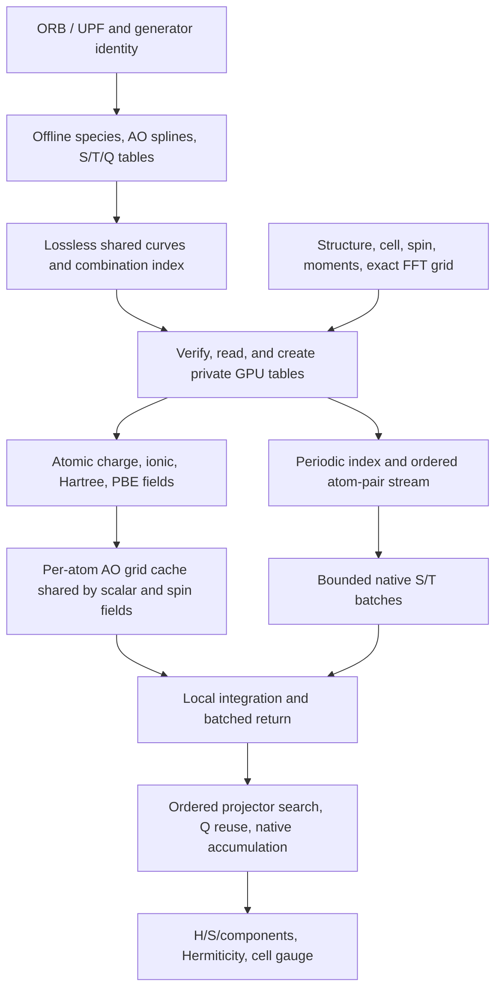

# H0 assembly and CUDA hot path

The engine builds atomic-charge `H0 = T + Vnl + Vion + VH[rho0] + Vxc[rho0]`
and S. Its reference is ABACUS initial HR0, before a density update or SCF
convergence.



## Data lifetimes

| Data | Identity | Reuse |
|---|---|---|
| Species and radial tables | ORB/UPF, spin/scalarization, grid, generator, binary | All structures with matching inputs |
| Shared curves | Grid and complete decoded coefficient bytes | Identical curves only; no grid interpolation |
| Master GPU tables | Table key, directory, device | Two-entry process LRU; consumers retain private copies |
| Charge and fields | Current geometry, grid, electrons, initial moments | Current assembly only |
| AO grid cache | Current orbitals, coordinates, FFT grid | Assembly LRU shared by scalar and spin fields |
| Projector candidates | Current source atom, geometry, session, cutoffs | Current atom's outgoing edges |
| Q factors | Species IDs and exact float64 displacement bytes | Assembly with explicit memory budget |
| S/T/local output buffers | Current bounded pair batch | Default 128 pairs; no prebuilt full N-squared output |

`pair_batches.scalar_pair_batches` makes one native S/T call per batch and
returns each tensor once, removes padding, then copies independent NumPy
blocks. Edge order and displacement arithmetic remain unchanged.
`CudaPeriodicFFTGridAOCache.contract_chunk` retains native pair integration
and returns one bounded batch. Scalar and spin fields share AO values,
lookup, and geometry support.

`PreparedProjectorCandidates` filters the fixed left atom once and uses arrays
for the right atom. Points near cutoff planes still use the original scalar
norm test; no epsilon expands support. Candidate order and exact Q keys remain
unchanged. Shared-store entry captures the numerical environment once for
contract comparison and key construction; there is no permanently trusted
process identity cache and old source claims are never updated.

## Explicit Python API

Inputs must come from verified physical configuration. Reference comparisons
can use `production_io.load_case(..., prepared_species=...)` for the exact
grid, moments, spin, and output-cell shifts.

```python
from dptb.priors.h0.assemble import assemble_h0
result = assemble_h0(
    structure, species_data, **physics_options,
    offline_table_dir=shared_table_directory,
    two_center_backend='pyabacus', cuda_precompiled=True,
    compute_device='cuda:0', field_backend='torch',
    structure_factor_backend='cufinufft', structure_factor_nthreads=1,
    strict_reproduction=False,
    local_integration='fft_grid_periodic', spatial_backend='indexed',
    pair_support='nonlocal_complete', hermitize=False,
    projector_search='anchor', projector_reuse_max_mb=256,
    cuda_pair_batch_size=128,
    field_max_work_mb=8192, structure_factor_max_work_mb=12288,
    local_cache_max_mb=4096,
)
```

`strict_reproduction=False` is an explicit option for the existing NUFFT route.
Supply the original FFT grid and cutoffs and validate H/S directly; this does
not relax the reference accuracy requirement. Setting `cuda_pair_batch_size=1`
selects single-pair S/T calls but does not restore an entire historical release.
Anchor search and Q reuse retain their explicit selectors. The CPU reference
uses its existing flow. The generic reconstruction CLI does not expose every
CUDA/prepared-store parameter; this Python API supports explicit configuration.

## Memory, timing, and regression boundaries

S/T GPU buffers occupy `2 * batch_size * max_norb**2 * 8` bytes; CPU buffers and
final matrices are separate. Local-output peaks include per-pair results and
the concatenation buffer. `local_cache_max_mb` budgets one shared SOC AO cache;
Q has a separate budget. Fields, master/consumer tables, native pair workspace,
and final matrices are excluded. Shared disk tables expand on GPU, and
nondefault CUDA streams retain event waits and `record_stream` lifetime guards.

End-to-end assembly timings synchronize CUDA before and after `assemble_h0`
and include table verification/load/copy, fields, all blocks, metadata, and
cell conversion. Input parsing, reference-file reads, and output serialization
are excluded. Profiling is diagnostic and its instrumented time is not a speed
claim. Native local integration still includes pair validation, index filters,
and CPU boundary reads.

Changes must preserve all H/S/T/local/nonlocal block keys, shapes, dtype, and
bytes against the fixed baseline, plus independent ABACUS errors. Cover
scalar/SOC, varied orbital counts, periodic images, cutoffs and adjacent float
values, eviction, and nondefault streams. A batch-size change must retain the
physical result. Local performance evidence does not establish full numerical
acceptance or DeePTB end-to-end acceleration.
